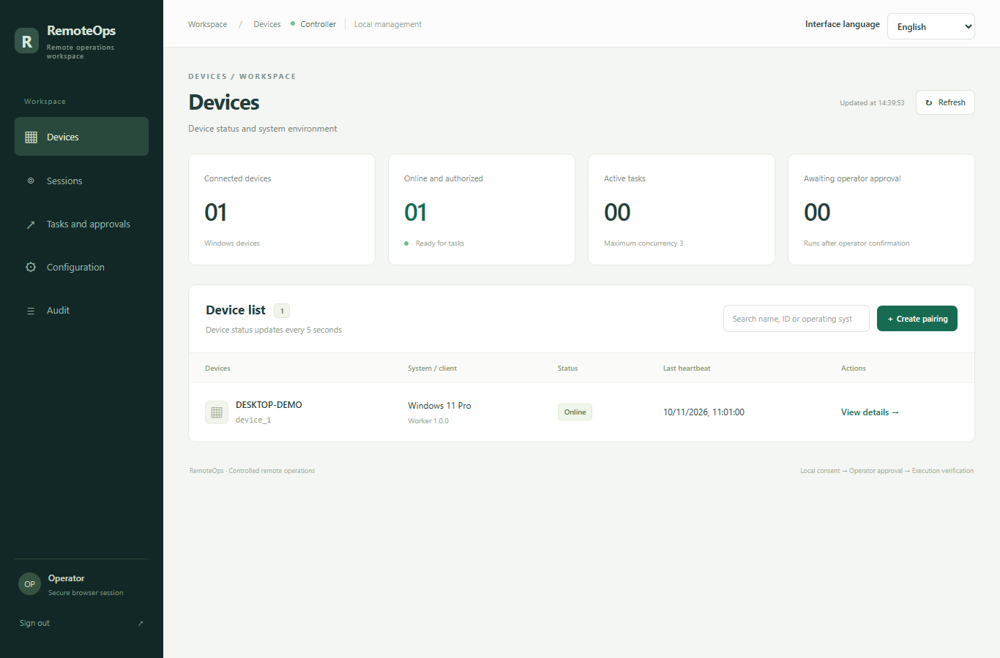
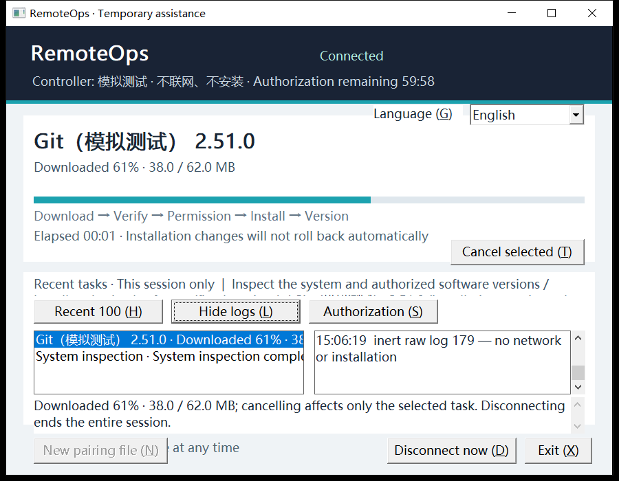

# RemoteOps

**Remote software installation and system inspection for temporary Windows devices, with explicit consent, approvals, and visible progress.**

[简体中文](README.md) · English

RemoteOps helps you assist colleagues, customers, or family members with setting up a Windows PC. The operator manages devices and tasks in a web workspace. The device user reviews the authorization, follows progress in a standalone client, and can disconnect at any time.

It is designed for temporary environment setup, software installation, and system inspection. Both sides can follow the work, from agreeing on its scope to checking the outcome.

## Features

- **Web workspace**: View devices, sessions, tasks, approvals, and operation records in one place.
- **Windows desktop client**: A standalone window shows the current software, download progress, execution stages, and logs.
- **Command-line client**: Choose an interactive terminal interface or a mode with line-by-line prompts.
- **Controlled installation and inspection**: Inspect the system, install specified software, and verify results within the session's authorized scope.
- **Explicit consent and approvals**: The device user confirms the scope of assistance. Installation tasks require operator approval, and administrator access requires local confirmation.
- **AI assistant integration**: Codex, Claude Code, and other MCP clients can query devices, prepare installation plans, and track tasks while retaining human approval.
- **Chinese and English interfaces**: Select and save a language preference in the web workspace and client.

## How it works

1. **Start a session**: The operator creates a temporary session in the web workspace and selects the allowed operations and software.
2. **Review the scope**: The device user opens the client, loads the pairing file, and reviews the authorization.
3. **Connect**: After explicit local consent, the two sides connect through the Tailscale network.
4. **Approve and execute**: The operator submits tasks under the authorization and approval rules. The client shows the software, stage, and progress.
5. **Review and finish**: Check results and logs, then close the session. The device user can also disconnect at any time.

## Screenshots

The screenshots below use sample devices and tasks.

### Web workspace

Check device availability and access session, task, and approval management.

### Windows desktop client

The device user can follow the current software, download progress, and detailed logs, cancel a task, or disconnect immediately.

### Terminal client

Use the keyboard to browse tasks, expand logs, and manage the connection. This example shows the Chinese interface.

## Getting started

The device client supports Windows 10/11 x64. The operator's management application supports Windows, Linux, and macOS. Prepare a Tailscale network connection before first use.

- [Setup, usage, and development](docs/getting-started.md) (Chinese): prerequisites, startup, pairing, and AI assistant integration.
- [Windows client guide](docs/worker-client.md) (Chinese): desktop and terminal controls, progress, and disconnection.
- [Language settings](docs/language-settings.md) (Chinese): switching and saving the interface language.

RemoteOps operates within the scope confirmed for the temporary session. Cancelling or disconnecting does not guarantee that software changes already made will be rolled back.
