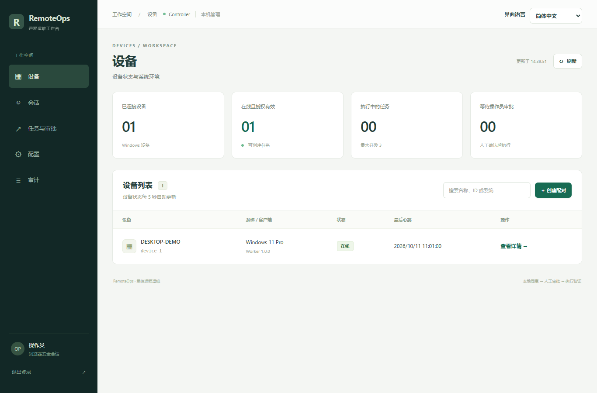
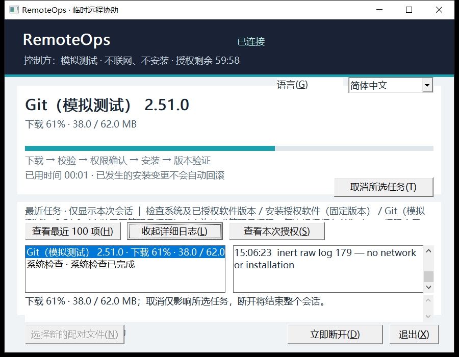

# RemoteOps

**为临时 Windows 设备提供有授权、可审批、可跟踪的远程软件安装与系统检查。**

简体中文 · [English](README.en.md)

RemoteOps 帮助你远程协助同事、客户或家人配置 Windows 电脑。协助方通过网页管理设备与任务，设备使用者通过独立客户端核对授权、查看进度，并可随时断开连接。

它适合一次性的环境准备、软件安装和系统检查：从明确本次协助范围，到确认执行结果，双方都能看到正在发生什么。

## 主要功能

- **网页管理工作台**：集中查看设备、会话、任务、审批和操作记录。
- **Windows 桌面客户端**：提供独立窗口，显示当前软件、下载进度、执行阶段和日志。
- **命令行客户端**：提供可交互的终端界面，也支持逐行提示模式。
- **受控的软件安装与检查**：在本次授权范围内检查系统、安装指定软件并验证结果。
- **明确的授权与审批**：设备使用者先确认协助范围，安装任务由操作员审批；需要管理员权限时由本机用户确认。
- **AI 助手接入**：支持 Codex、Claude Code 等通过 MCP 查询设备、准备安装计划和跟踪任务，保留人工审批环节。
- **中英文界面**：网页和客户端均可选择简体中文或英文，并保存语言偏好。

## 如何协作

1. **发起协助**：协助方在网页创建临时会话，选择允许的操作和软件。
2. **确认授权**：设备使用者打开客户端，读取配对文件并核对本次协助范围。
3. **建立连接**：用户明确同意后，双方通过 Tailscale 网络连接。
4. **审批与执行**：协助方提交任务，按授权和审批要求执行；客户端同步显示软件、阶段和进度。
5. **查看结果并结束**：核对结果与日志，完成后关闭会话；设备使用者也可随时断开。

## 界面预览

以下界面使用模拟设备和任务展示。

### 网页工作台

查看设备在线情况，并进入会话、任务与审批管理。

### Windows 桌面客户端

设备使用者可以看到当前软件、下载进度和详细日志，也可以取消任务或立即断开。

### 终端客户端

通过键盘查看任务、展开日志和管理连接，适合习惯命令行的用户。

## 开始使用

设备端支持 Windows 10/11 x64，协助方管理端支持 Windows、Linux 和 macOS。首次使用需要准备 Tailscale 网络连接。

- [部署、使用与开发](docs/getting-started.md)：环境准备、启动、配对和 AI 助手接入。
- [Windows 客户端使用指南](docs/worker-client.md)：图形界面、终端操作、进度和断开连接。
- [语言设置](docs/language-settings.md)：中英文切换与保存。

RemoteOps 按临时会话中确认的范围执行操作。取消或断开不保证回滚已经发生的软件修改。
