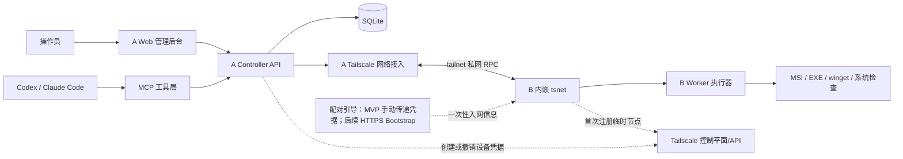
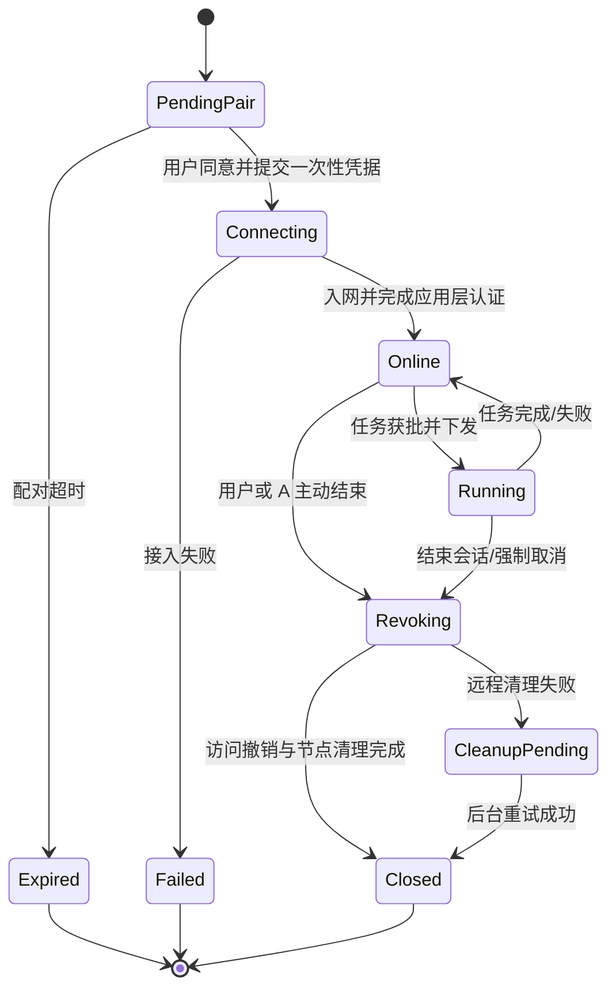

# RemoteOps：基于 Tailscale 的临时设备 Agent 远程安装系统

> **产品需求文档（PRD）**  
> 版本：v1.0（MVP 需求基线）  
> 日期：2026-10-11  
> 状态：待开发  
> 适用对象：产品负责人、架构师、Go/Windows 开发工程师、前端工程师、Codex / Claude Code 开发 Agent

---

## 1. 项目概述

### 1.1 背景

使用者在 **A 端**运行 Codex CLI、Claude Code 等 AI Agent，需要跨互联网连接异地、无公网 IP 的 **B 端 Windows 电脑**，并根据自然语言要求，在 B 上完成软件下载、静默安装、系统配置和结果验证。

B 端数量不固定，以**短时、一次性使用**为主：新 B 加入 → 临时授权 → 执行安装 → 验证 → 退出并撤销授权。随后可接入不同的新 B，累计接入设备数量可能很大，但同时在线数量相对较少。

不要求 B 用户单独安装 Tailscale、SSH 服务或 AI Agent 框架。B 下载并运行项目提供的轻量客户端即可。

### 1.2 产品定位

一个**以 Agent 驱动、面向临时 Windows 设备的软件安装与配置工具**，不是以屏幕控制为核心的通用远程桌面产品。

- **网络连通**：通过 Tailscale 构建加密的私有网络；B 通过 Go `tsnet` 内嵌网络能力。
- **执行控制**：通过 A 的 Controller API 和 B 的任务执行器，执行经授权的安装任务。
- **Agent 集成**：Codex / Claude Code 通过 MCP 调用 Controller，不直接获取 B 的管理员密码。
- **可视化管理**：A 上提供轻量 Web 后台，用于配对、管理设备、查看任务、审计和设置。

### 1.3 核心目标

1. A 和 B 位于不同内网，无需 B 的公网 IP 或路由器端口映射。
2. B 使用单个 Windows 可执行文件；无需独立安装 Tailscale 或 OpenSSH。
3. B 操作由设备使用者明确同意；涉及管理员权限时经 Windows UAC 正式授权。
4. A 能通过 Agent 对指定 B 下发安装任务，并获得输出、进度、退出码和验证结果。
5. B 离线或安装结束后，会话立即失效，临时节点被主动清理或进入兜底回收流程。
6. A 端管理网页和 MCP 使用**同一个 Controller API**。
7. 代码便于使用多 Agent / Git worktree 并行开发，并支持未来扩展到多 A、多租户。

### 1.4 非目标（MVP 不做）

- 远程桌面画面、鼠标键盘接管、无人值守 GUI 点击。
- 绕过 Windows UAC、企业终端策略、杀毒软件或软件许可。
- B 端长期驻留、Windows 系统服务、开机自启。
- 任意远程 Shell 完全开放、从未授权会话运行任意脚本。
- 公网 SaaS 多租户、支付计费、复杂工单系统。
- macOS/Linux B 端正式支持（保留跨平台接口）。
- 大规模 7×24 小时运维平台功能。

---

## 2. 角色与使用场景

| 角色 | 职责 | 初版入口 |
|---|---|---|
| A 端操作员 | 创建配对会话、选择设备、确认高风险任务、检查结果 | Web 后台 |
| A 端 Agent | 将自然语言目标拆解为受控的安装/检查任务 | MCP 工具 |
| B 端设备使用者 | 启动客户端、批准本次连接和安装范围、终止会话 | Windows 客户端 |
| Controller 服务 | 授权、设备发现、任务调度、状态收集、审计 | Go API |
| B Worker | Tailscale 网络接入、身份认证、执行本地任务、日志回传 | Go EXE |

### 2.1 主要场景

1. **安装开发环境**：在新 B 上安装 Git、Python、Node.js 或其他支持无交互安装的软件。
2. **部署特定软件栈**：安装 ComfyUI 相关运行环境、依赖和组件；特殊依赖或驱动问题由 Agent 分析并请求确认。
3. **检查环境**：读取系统版本、CPU/GPU、磁盘余量、软件版本和安装状态。
4. **失败诊断**：将安装日志返回 A，Agent 分析错误并提交下一条经授权的修复任务。
5. **自动清理**：完成后断开 B 的会话和私网身份；保留最小必要的任务审计记录。

### 2.2 标准用户旅程

1. A 操作员创建一条临时会话（例如有效期 10 分钟的配对码；**此值为可配置的产品默认建议**）。
2. B 用户下载/运行 `remoteops-worker.exe`，查看本次远程操作说明。
3. B 用户输入或扫描配对信息，确认信任的控制方、任务范围和授权时长。
4. B 客户端通过安全引导流程获取**短期、最小权限、单次使用**的网络凭据，加入 tailnet。
5. B 向 A 上报设备信息和会话状态，A 网页出现“在线 / 待任务”。
6. A 上的 Agent 调用 MCP：检查环境、提出安装计划、等待必要的确认、下发安装。
7. B 在已获得的本机权限范围内执行；不满足权限时要求本地用户完成 UAC 提升。
8. A 展示任务实时输出，验证软件版本和最终状态。
9. A/B 任一方结束会话：停止新任务、撤销访问、清理临时节点和本地临时敏感信息。

---

## 3. 关键架构决策

| 项目 | 选择 | 原因 |
|---|---|---|
| 代码仓库 | **Monorepo** | 协议共享、便于跨端协作与版本同步 |
| A/B 交付 | **两个独立程序** | A、B 分别运行/发布，B 无需 Agent 框架 |
| 主语言 | **Go** | `tsnet` 原生支持，易编译 Windows EXE |
| A Web | Vue 3 + TypeScript（建议） | 轻量设备/任务界面 |
| 数据存储 | SQLite（MVP） | 单 A、少量并发、部署简单 |
| 网络 | A 官方 Tailscale 客户端；B 内嵌 `tsnet` | MVP 成本低、方便 A 本机调用其他工具 |
| 通信 | HTTP(S)/JSON over tailnet；后续可换 gRPC | 实现、测试、排查简单 |
| Agent 集成 | MCP 工具适配层 | Codex/Claude Code 使用同一套业务 API |
| Windows 执行 | 安装器适配器：MSI / EXE 静默参数 / winget | 避免依赖 GUI 点击 |
| B 端部署 | 临时、可退出的 EXE | 符合一次性访问诉求 |
| Web 暴露 | A 端默认只监听 `127.0.0.1` | 降低暴露面 |

### 3.1 逻辑架构



说明：图中的 Tailscale 控制平面负责节点协调、身份和策略；安装任务/日志经 A 与 B 的私网业务通道传输。实际流量可能是点对点连接，也可能经加密中继。**Tailscale 连通不等于应用操作授权。**

### 3.2 B 端不采用官方 Tailscale SSH

- 官方 Tailscale SSH **服务端不支持 Windows**；MVP 不依赖其提供 Windows SSH 入口。
- B 使用 `tsnet.Server.Listen(...)` 在 tailnet 内暴露项目自己的受控 RPC 服务。
- A 通过 HTTP(S)/JSON API 调用 B 的安装/检查功能。
- `tsnet` 嵌入不等于在 Windows 全系统安装一个可供所有进程使用的 Tailscale 虚拟网卡；它主要为当前程序提供网络能力。

### 3.3 连接模式

- **MVP**：A 运行 Controller 与 Tailscale；B 通过 `tsnet` 加入相同 tailnet；B 注册信息后 A 主动连接 B 的 RPC 服务。
- **注册引导**：由于 B 在加入 tailnet 前不能访问 A 的私网 API，第一版允许操作员以安全带外方式给 B 提供一次性入网/配对信息。
- **产品化扩展**：增加公网 HTTPS Bootstrap 服务，仅用于验证配对码和签发最小权限的短期入网凭据；不得把可复用的 Tailscale OAuth Secret 写进 B 的 EXE。
- **网络隔离**：通过 Tailscale grants/ACL，令 B 只访问完成注册所必需的 A 端点，令 A 只访问 B 的指定 RPC 端口；禁止 B 横向访问其他 B 或 tailnet 资产。

---

## 4. 功能需求

优先级：**P0 = MVP 必需；P1 = 下一阶段；P2 = 远期**。

### 4.1 A Controller

| ID | 优先级 | 功能 | 验收要点 |
|---|---|---|---|
| C-01 | P0 | 设备注册和发现 | B 建立会话后可显示设备 ID、Windows 版本、客户端版本、私网地址、最后心跳 |
| C-02 | P0 | 会话管理 | 创建、查询、过期、手动关闭会话；会话关闭后拒绝新任务 |
| C-03 | P0 | 任务调度 | 对单个 B 下发已授权的安装/检查任务，返回唯一 `task_id` |
| C-04 | P0 | 状态与日志 | 记录排队、执行中、成功、失败、取消；可查看时间戳、退出码及有界日志 |
| C-05 | P0 | 身份与权限校验 | Web/MCP 统一鉴权；严格校验设备绑定、会话有效期和任务范围 |
| C-06 | P0 | 连接清理 | 会话结束尝试撤销 B 的设备访问与临时节点；失败后重试并记录 |
| C-07 | P0 | 配置管理 | 管理并发数、任务超时、配对码有效期、日志留存配置 |
| C-08 | P1 | 多设备任务队列 | 控制并发上限，避免 Agent 同时大量执行任务 |
| C-09 | P1 | 模板任务 | Git/Python/ComfyUI 环境检查与安装模板 |
| C-10 | P2 | 多用户/多 A | 组织、角色、工作空间、跨 A 调度 |

### 4.2 B Windows Worker

| ID | 优先级 | 功能 | 验收要点 |
|---|---|---|---|
| B-01 | P0 | 单 EXE 启动 | Windows 10/11 x64 能启动，不依赖预装 Tailscale/OpenSSH/AI Agent |
| B-02 | P0 | 显示授权信息 | 清晰显示控制方身份、会话 ID、任务范围和退出操作 |
| B-03 | P0 | 临时入网 | 内嵌 `tsnet` 注册，使用临时节点身份并显示连接状态 |
| B-04 | P0 | 本地权限检查 | 能区分普通用户令牌与真正提升的管理员令牌；需要提权时提示用户 |
| B-05 | P0 | 任务接收与校验 | 验证请求身份、会话、授权范围、重放/幂等信息，拒绝未授权任务 |
| B-06 | P0 | 系统检查 | 读取 OS、CPU、内存、磁盘、GPU/驱动、指定软件版本等必要信息 |
| B-07 | P0 | 软件安装 | 支持经过授权的 MSI、指定 EXE 静默安装和限定的包管理安装方案 |
| B-08 | P0 | 执行状态上报 | 实时/分段上传 stdout/stderr、退出码及进度；对敏感字段脱敏 |
| B-09 | P0 | 超时/取消 | 任务超时或会话终止时停止新任务；尽力终止受控进程树 |
| B-10 | P0 | 安全退出 | 用户可随时结束，清理凭据和临时目录；正常退出优先主动注销节点 |
| B-11 | P1 | 文件传输 | 有文件名、大小、SHA-256、目标目录校验的安装包上传下载 |
| B-12 | P1 | 重启协调 | 需要重启时明确提示用户，批准后执行，重启后的恢复另行设计 |
| B-13 | P2 | GUI 自动化 | 通过独立的用户会话模块实现 UI Automation，不尝试绕过 UAC 安全桌面 |

**B 客户端权限要求**：只在必要动作上请求管理员权限；用户授予权限不意味着 A 可以无限制调用所有系统命令。MVP 的命令执行必须走明确的任务类型、参数校验和人工授权边界。

### 4.3 A Web 后台

| 页面 | 优先级 | 展示/操作项 |
|---|---|---|
| 设备管理 | P0 | 在线/离线、主机名、系统版本、连接时长、最后心跳、断开 |
| 临时会话 | P0 | 创建配对、授权范围、剩余有效期、会话状态、关闭 |
| 任务管理 | P0 | 新建安装/检查任务、执行状态、日志、退出码、取消 |
| 系统配置 | P0 | Tailscale 连接状态、并发/超时、软件安装策略、日志设置 |
| 审计记录 | P0 | 谁、何时、对哪台设备执行了什么动作及结果 |
| 模板库 | P1 | 常用软件安装模板、参数校验、版本管理 |

前端只负责调用 Controller API，不直接读写 Tailscale OAuth Secret，不允许通过浏览器直接暴露任意 B 端任务执行能力。

### 4.4 MCP / Agent 工具

MVP 提供结构化 MCP 工具，避免把底层“执行任意 PowerShell”作为默认接口：

| MCP 工具（建议名称） | 用途 | 风险控制 |
|---|---|---|
| `list_devices` | 列出当前已授权设备 | 只返回必要元信息 |
| `get_device_info` | 查询指定 B 的环境信息 | 只读 |
| `create_install_plan` | 生成候选安装步骤与预计变更 | 不执行 |
| `request_task_approval` | 对重要安装/系统修改请求人工确认 | 审批绑定任务摘要与会话 |
| `install_software` | 触发批准的软件安装任务 | 软件标识/版本/来源校验 |
| `get_task_status` | 查看状态与退出码 | 只读 |
| `get_task_logs` | 查询脱敏日志 | 访问控制、分页/长度限制 |
| `cancel_task` | 取消未完成任务 | 需要当前会话权限 |
| `close_session` | 结束会话并撤销权限 | 立即拒绝后续指令 |

Agent 负责**规划与解释**；Controller/B Worker 负责**权限校验与执行**。即使 Agent 自己声明“已获授权”，也必须以 Controller 保存的审批结果为准。

---

## 5. 临时设备与生命周期设计

### 5.1 状态机



### 5.2 Ephemeral Node 规则

- B 优先注册为 **Tailscale Ephemeral Node**，每次接入使用新的临时会话身份；不能将“同一机器再次加入”默认为原会话授权延续。
- `tsnet.Server.Ephemeral` 可将嵌入式应用注册为临时节点；仍需验证具体版本与 auth key 配置。
- Tailscale 文档说明，短时离线临时节点通常在一段时间后自动清理（官方当前说明通常约 30–60 分钟），**不是关闭 EXE 的瞬间立即消失**。
- **MVP 退出要求**：先在本系统内立即作废会话/拒绝新任务；随后尽最大努力通过安全、受支持的方式注销节点或由 A 调用 Tailscale 管理 API 删除节点；失败则定期重试。
- 不能依赖同一个旧 IP 识别后续新 B；以内部设备 ID / 会话 ID 建立映射。
- 一次性配对/入网授权凭据不可写死到公开安装包，亦不可长时间保留在明文日志中。
- 异常退出时，A 需要根据心跳 TTL 判定离线并撤销应用层权限；节点管理侧由补偿任务清理。

### 5.3 扩容原则

- 历史 B 总数与同时在线 B 数量是两个不同指标。
- 连接容量首先受 Tailscale 资源计费/管理策略影响；任务并发受 A 端资源、B 性能、下载安装带宽影响。
- 初版建议设置可配置并发上限（示例默认 3，非平台限制），同一 B 默认只允许一个破坏性安装任务同时执行。
- 记录每台设备的会话起止时间、临时节点使用分钟数和清理状态，用于容量与成本核算。

---

## 6. Windows 软件安装执行规则

### 6.1 支持顺序

1. MSI：`msiexec` 静默安装，解析退出码（如 0、3010）。
2. 明确支持无界面参数的 EXE：基于**受维护的安装模板**声明参数，不盲目猜测 `/S`、`/silent`。
3. `winget`：有明确软件 ID、来源与版本策略时使用；考虑不同 Windows 环境中可用性与交互条款。
4. PowerShell：仅限签名或经审批的、参数化的受控脚本模板；默认不提供任意脚本入口。

### 6.2 安装任务数据模型

建议每条安装任务至少包含：

```json
{
  "task_id": "task_example_001",
  "session_id": "sess_example_001",
  "device_id": "dev_example_001",
  "type": "install_package",
  "package": {
    "source_type": "approved_catalog",
    "id": "git",
    "version": "approved-or-latest-pinned-by-policy",
    "sha256": "required-for-downloaded-artifact"
  },
  "timeout_seconds": 1800,
  "requires_admin": true,
  "approval_id": "approval_example_001",
  "idempotency_key": "idem_example_001"
}
```

这是**示意契约**，非已实现 API。实际字段应在开发前固定并校验。

### 6.3 执行隔离与失败处理

- 安装包默认下载到会话专属临时目录，检查来源和 SHA-256 后执行。
- 安装任务设置超时、工作目录、环境变量白名单、最大日志长度和退出码规则。
- 软件安装可能改变系统状态；“取消”通常不能保证回滚已经发生的修改。
- 显示是否需要重启；MVP 不自动重启用户机器。
- 若 UAC 提升被拒绝，明确标记为 `permission_denied`，不可尝试绕过。
- 安装失败需保留脱敏诊断信息并给 Agent 可执行的下一步建议，但新一轮高风险变更需再次审批。

---

## 7. 身份鉴权、授权与安全要求

本项目涉及远程高权限执行，应把以下内容当作上线阻断条件，而非后期优化。

### 7.1 三层授权

1. **网络层（Tailscale）**：设备只能访问明确允许的 tailnet 端点及端口；B 不能访问其他 B。
2. **会话层（Controller）**：每次 B 接入必须绑定唯一会话、设备身份、时间范围、操作员和临时授权。
3. **操作层（Task approval）**：任务类型、参数、执行对象及管理员权限范围必须经校验；危险操作要求显式审批。

### 7.2 P0 安全需求

- S-01：A Web 仅绑定本机回环地址；默认启用登录会话保护，暴露到其他设备前必须启用 HTTPS 和身份认证。
- S-02：MCP 仅供可信的本机调用者访问；不得对公网暴露无认证的 MCP/命令接口。
- S-03：B 必须展示控制方身份、任务范围，支持明显可见的“立即断开”操作。
- S-04：不接受仅凭 IP、设备名或 tailnet 成员资格而执行命令；使用应用层相互身份校验和会话授权。
- S-05：禁止把 Tailscale OAuth Secret、长期可复用 Auth Key、管理员密码、API Token 打包进 B 可执行文件。
- S-06：敏感操作采用短期、单次使用的凭据；请求包含有效期、nonce/幂等键和重放防护。
- S-07：安装文件需校验可信来源、允许的软件清单及摘要/签名（适用时）。
- S-08：Web、MCP、设备执行统一审计；默认遮盖令牌、密码、Cookie、私钥等敏感内容。
- S-09：Windows UAC 应由 B 本地用户正式批准；不得通过禁用 UAC 等方式规避。
- S-10：会话关闭、配对码过期或用户撤销时，后续任务立即失败；清理失败必须可见、可重试。
- S-11：强烈建议区分低权限通信进程和受控的提权执行组件；若 MVP 采用整进程提权，必须收窄 RPC 指令类型并记录风险。
- S-12：客户端不应悄悄持久化、伪装系统服务或在用户不知情时远程运行。

### 7.3 资产与留存

- B 的完整桌面文件、浏览器资料、个人文档不属于默认采集范围。
- 仅采集完成安装所需的环境信息、任务日志及审批证据。
- 审计记录保留期设为可配置，MVP 建议默认 30 天；敏感安装文件执行后清理。
- 若未来商业化，应额外设计隐私告知、用户同意、数据删除和多租户隔离。

---

## 8. API 与事件契约（初稿）

### 8.1 Controller HTTP API（示例）

| 方法 | 路径 | 说明 |
|---|---|---|
| `POST` | `/api/v1/sessions` | 创建一次性配对会话 |
| `GET` | `/api/v1/sessions/{id}` | 查询会话状态 |
| `POST` | `/api/v1/sessions/{id}/close` | 关闭并撤销会话 |
| `GET` | `/api/v1/devices` | 获取当前设备列表 |
| `GET` | `/api/v1/devices/{id}` | 获取单台设备能力、环境信息 |
| `POST` | `/api/v1/tasks` | 创建任务（需授权） |
| `GET` | `/api/v1/tasks/{id}` | 查询任务 |
| `GET` | `/api/v1/tasks/{id}/logs` | 分页读取日志 |
| `POST` | `/api/v1/tasks/{id}/cancel` | 取消任务 |
| `GET` | `/api/v1/audit-events` | 审计记录 |

### 8.2 Worker 内网 RPC（示例）

- `GET /health`：最小健康检查（需会话认证，不返回敏感信息）。
- `POST /v1/tasks`：接收经授权的结构化任务。
- `GET /v1/tasks/{id}`：读取本机执行状态。
- `GET /v1/tasks/{id}/logs`：读取分段日志。
- `POST /v1/tasks/{id}/cancel`：尝试终止运行中的任务。
- `POST /v1/session/close`：结束会话。

**正式开发前需要固定**：认证头和签名方式、字段类型、错误码、超时语义、日志分页机制、客户端兼容版本、事件去重和异常恢复策略。

### 8.3 任务状态

`pending_approval` → `queued` → `running` → `succeeded | failed | cancelled | timed_out`

其中：
- 权限被拒绝：`failed`，错误码 `permission_denied`。
- 网络中断：`running` 可能进入 `unknown`/`disconnected`，不能未经核查自动重复执行有副作用的安装操作。
- 重放或重复请求：相同 `idempotency_key` 不可导致重复安装。

---

## 9. 非功能需求

| 项目 | MVP 目标/约束 | 验证方式 |
|---|---|---|
| 平台 | B 优先 Windows 10/11 x64；A 优先 macOS/Linux | 真机/虚拟机验证 |
| 启动方式 | B 手动启动单 EXE，不要求管理员永久驻留 | 全新 Windows 环境验证 |
| 网络 | 无公网 IP、不同 NAT 下尽可能连通；允许经 Tailscale 中继 | 不同网络实测 |
| UI | A Web 简洁易用；设备状态和任务状态能及时刷新 | E2E 测试 |
| 日志 | 有时间戳、任务关联 ID；限制大小并脱敏 | 单元/E2E 测试 |
| 可恢复性 | Controller 重启后可恢复已落库状态；孤儿任务有超时处理 | 故障演练 |
| 可靠性 | B 中途关闭、断网、安装进程异常退出有确定的状态和清理逻辑 | 故障注入 |
| 并发 | MVP 先验证 1 A 对多个 B；并发上限可配置 | 3～10 台压测（建议） |
| 可维护性 | 共享 API schema；A/B 版本兼容可检查 | CI 契约测试 |
| 供应链 | 锁定依赖版本，CI 输出可追溯构建产物及哈希 | 构建检查 |

注意：本表中的压测规模、30 天日志保留等均为**建议的产品目标**，不是 Tailscale 官方承诺。

---

## 10. 代码组织与开发协作

### 10.1 Monorepo 结构建议

```text
remote-ops/
├── cmd/
│   ├── controller/            # A 控制端入口
│   └── worker/                # B Windows 客户端入口
├── internal/
│   ├── controller/
│   │   ├── devices/
│   │   ├── sessions/
│   │   ├── tasks/
│   │   ├── approvals/
│   │   ├── audit/
│   │   └── tailscale/
│   ├── worker/
│   │   ├── pairing/
│   │   ├── network/
│   │   ├── executor/
│   │   ├── installers/
│   │   └── privilege/
│   └── security/
├── pkg/
│   └── protocol/              # 跨端协议结构和错误码
├── api/
│   └── openapi.yaml
├── integrations/
│   └── mcp/                   # MCP 工具适配
├── web/                       # Vue 3 后台
├── docs/
│   ├── architecture/
│   ├── decisions/
│   ├── security/
│   └── test-plans/
├── scripts/
├── tests/
│   ├── integration/
│   └── e2e/
├── go.mod
└── README.md
```

### 10.2 并行开发约束

- 首先冻结 `api/openapi.yaml`、`pkg/protocol` 和会话状态机。
- Agent 1 负责 `internal/controller` + API；Agent 2 负责 `internal/worker`；Agent 3 负责 `web`；集成由主 Agent 负责。
- 各 Agent 使用独立 Git worktree/分支，避免并行修改同一组协议文件。
- 必须在 CI 中执行 Go 单元测试、协议兼容测试、静态检查、Web 构建和关键安全测试。
- 尽量让 Web/MCP 复用 Controller API，避免形成重复业务逻辑。

---

## 11. 分阶段交付

### Phase 0：技术验证（Spike）

- A 官方 Tailscale + B 内嵌 `tsnet` 互通。
- Windows 单 EXE 连接/退出，临时节点注册与清理行为验证。
- 从 A 向 B 发送一个**只读系统信息查询**，取得可靠日志/结果。
- 确认 B 无管理员权限时能受控运行，提权逻辑遵循 UAC。
- 对不同 NAT、断线情况做最小可行性验证。

**退出标准**：真实异地网络上可以稳定查询 B 环境，B 退出后 Controller 立即停止授权，新请求无法继续执行。

### Phase 1：核心 MVP（优先交付）

- Controller API / SQLite / 会话与设备管理。
- B Windows EXE / tsnet / 配对 / 系统信息读取。
- 1～2 种指定的软件安装适配器（如 MSI + Git 安装）。
- 审批、日志、任务状态、取消和清理。
- MCP 最小工具集。
- A Web：设备、会话、任务、日志四个核心视图。

**退出标准**：A 可以通过 Codex/Claude Code 在被授权 B 上安装指定软件，展示日志并验证版本，随后成功结束会话。

### Phase 2：增强

- HTTPS Bootstrap 自动配对，无需手工传递入网凭据。
- 安装包传输、SHA-256/签名校验、失败恢复与模板库。
- 多设备队列、并发管理、任务重试策略、网络监控。
- Windows GUI 安装辅助（需独立评估与明确用户授权）。
- 更精细权限模型、软件包可信发布、代码签名。

### Phase 3：产品化

- 多 A、多租户、企业策略、集中运营后台。
- 按实际部署模式评估 Tailscale 商业/OEM/合作伙伴协议。
- 如供应商计费或商业授权不合适，可抽象网络传输接口，评估自建协调/中继或 B 主动 WSS 连接中心服务。

---

## 12. MVP 验收测试清单

### 功能验收

- [ ] B 未安装官方 Tailscale、OpenSSH 或 Codex，仍能运行客户端并通过 `tsnet` 加入网络。
- [ ] B 首次启动会显示本次授权范围和明显的退出入口。
- [ ] A Web 出现 B 的设备信息、在线状态和会话信息。
- [ ] Codex/Claude Code 可以通过 MCP 列出 B 并查询 Windows/CPU/磁盘信息。
- [ ] A 下发经批准的 MSI/软件模板安装任务，B 返回输出、退出码和安装验证结果。
- [ ] 软件缺失、网络失败、磁盘空间不足、UAC 被拒绝时均能给出明确错误。
- [ ] A/B 任意一方结束会话后，B 不再接受新任务。
- [ ] B 临时节点可被清理；清理失败时显示待处理并可重试。

### 安全验收

- [ ] 过期配对码、复用配对码、错误控制端身份均无法连接。
- [ ] 未授权 Agent 无法通过 MCP 创建高权限任务。
- [ ] 设备 B1 无法访问 B2 或读取其他会话数据。
- [ ] 重放同一任务不会导致安装动作执行两次。
- [ ] 任务执行日志不包含 OAuth Secret、Auth Key 或其他敏感凭据。
- [ ] B 客户端不会绕过 UAC，用户拒绝提权后明确终止对应操作。
- [ ] Windows 客户端关闭或异常崩溃后，A 会话权限能按时过期并触发清理。

### 性能及兼容性验收

- [ ] Windows 10 / 11 x64 验证通过。
- [ ] A macOS / Linux 的构建和连接验证通过。
- [ ] 至少 3 个临时 B 顺序接入成功，且无历史节点身份混淆。
- [ ] 并发连接和大日志回传不会使 Controller 崩溃。
- [ ] 控制端重启后可正确重建可恢复的状态，不重复有副作用的安装。

---

## 13. 套餐、成本与授权说明（2026-10-11 核查）

> **下列为供应商公布的现行页面信息，仅作选型依据。价格与条款会变动，正式上线前应再次核实。**

| 套餐 | 官方标价 | Ephemeral 资源月度包含额度 | Tagged Resources 包含额度 |
|---|---:|---:|---:|
| Personal | $0 | 1,000 节点分钟 | 50 个 |
| Standard | $8 / 用户 / 月 | 1,000 节点分钟 | 50 个 |
| Premium | $18 / 用户 / 月 | 10,000 节点分钟 | 50 个 |
| Enterprise | 定制 | 定制 | 按合同 |

- 官方页面列出超过包含数量的 Tagged Resources 可按 **$1/个/月**增加；超额 Ephemeral 分钟需联系销售。
- Ephemeral 使用量以节点在 tailnet 中的**资源生命周期**计量，不应简单等同于“安装动作执行分钟数”。每台接入时间短，不等于历史接入数量没有业务成本。
- 官方说明：临时设备在 tailnet 中存在达到 **4 小时**后，不再从临时节点分钟池扣费，而按常规带标签资源计。
- 比如“每月 100 台 × 各占用 10 分钟 = 1,000 节点分钟”仅是**理想化估算**，应以供应商计费规则和真实节点记录核算。
- Personal 免费版可供个人原型和适用条件内的测试；**给外部客户批量分发嵌入 Tailscale 的程序并收费，不应默认认为个人版或自助商业套餐已授予转售/OEM 权利**。商用前与 Tailscale 商务/法务确认许可、合作伙伴或 OEM 方案。
- 采用普通 Tagged Resources + 使用完主动删除，也是需要评估的备选方案；涉及额度、计费周期、API 权限和清理保障，需开展独立 PoC。

**成本评估需要记录的实际参数**：每天新增 B 数、单次平均在线时长、最大同时在线 B 数、是否商业服务、是否需要统一用户/客户隔离。

---

## 14. 风险与待决策事项

| 编号 | 风险 / 决策 | 建议 |
|---|---|---|
| R-01 | B 首次加入前无法访问 A 私网 | MVP 用安全带外配对；下一阶段建设 HTTPS Bootstrap |
| R-02 | Windows 需要 GUI/UAC 安装 | MVP 仅支持静默安装；GUI 自动化独立开发，绝不绕过 UAC |
| R-03 | 临时节点退出后仍暂留 | 应用层立即撤销，Tailscale 节点清理走 API / 重试 |
| R-04 | 高权限远程执行被滥用 | 严格的任务类型、权限隔离、设备可见同意、审计 |
| R-05 | Agent 错误判断安装命令 | 模板化执行 + 风险分级确认 + 安装后版本验证 |
| R-06 | 多个 B 共享 tailnet 的横向风险 | 最小权限 ACL，阻止 B↔B，限制 A→B 端口 |
| R-07 | 商业使用与大规模计费不确定 | 商业上线前书面核实 Tailscale 协议、资源价格和额度 |
| R-08 | 安装操作中途断网/退出 | “未知状态”不可自动重放，先检测真实安装状态再恢复 |
| R-09 | 复杂软件安装、重启和驱动 | 第一版只交付稳定的静默安装模板，逐步扩充 |
| R-10 | 单文件 EXE 的代码签名和安全告警 | 商业发布前规划签名和可信分发，避免错误报警 |

### 14.1 默认假设（如无新要求按此开发）

- 首版仅一个可信 A 操作员，不做多租户。
- 首版 B 仅 Windows 10/11 x64，用户始终在场并知情同意。
- 安装任务集中在静默安装、系统检查与环境配置。
- Web 后台在 A 本机运行；B 的首次入网凭据通过安全带外方式分发。
- 不做未授权的、隐藏的、持久性远程控制功能。
- 不把任何 Tailscale 付费能力视为保证免费可用；以账号对应套餐及实际计费为准。

---

## 15. 官方参考资料

1. Tailscale tsnet 概览：https://tailscale.com/docs/features/tsnet
2. Tailscale tsnet.Server API：https://tailscale.com/docs/reference/tsnet-server-api
3. Tailscale 临时节点：https://tailscale.com/docs/features/ephemeral-nodes
4. Tailscale 定价：https://tailscale.com/pricing
5. Tailscale SSH 适用平台：https://tailscale.com/kb/1193/tailscale-ssh
6. Tailscale OAuth Clients：https://tailscale.com/kb/1215/oauth-clients
7. Tailscale 合作伙伴与商业方案：https://tailscale.com/partnerships
8. Microsoft Windows UAC 工作原理：https://learn.microsoft.com/en-us/windows/security/application-security/application-control/user-account-control/how-it-works

---

## 16. 项目一句话定义

**RemoteOps 是一个针对临时 Windows 设备的软件安装系统：A 端 Agent 通过 Controller + Tailscale 私网，控制已获用户授权的 B 端轻量客户端完成受控安装；A 端附带简洁的 Web 管理后台，B 使用完立即撤销操作权限并回收临时设备身份。**
