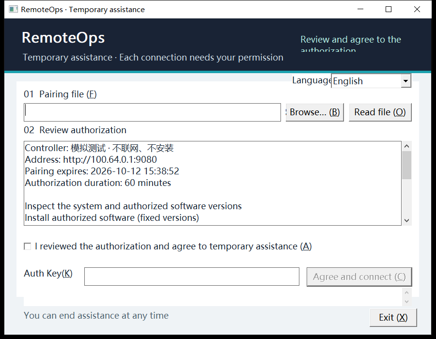
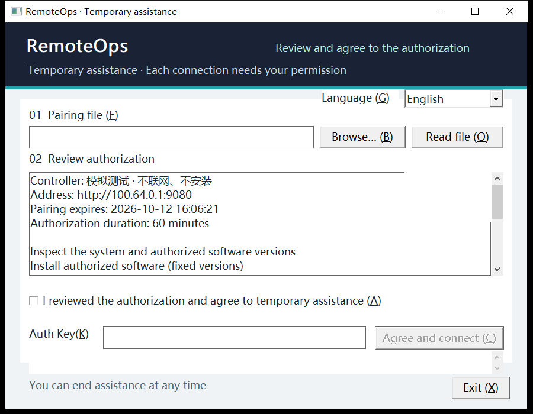
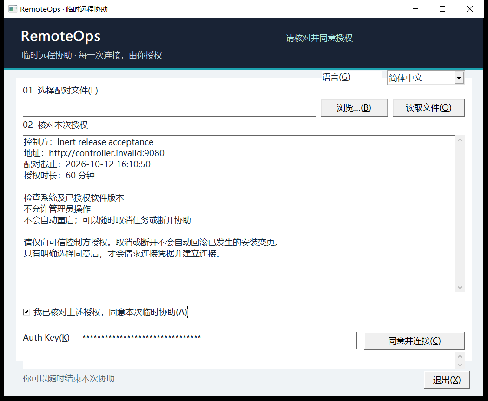
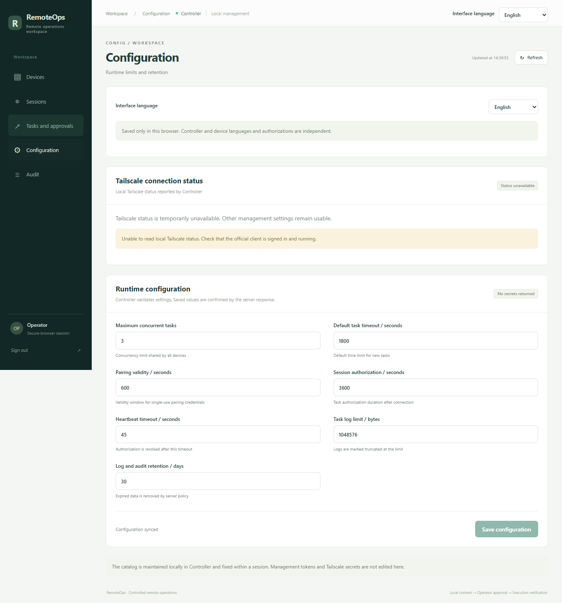
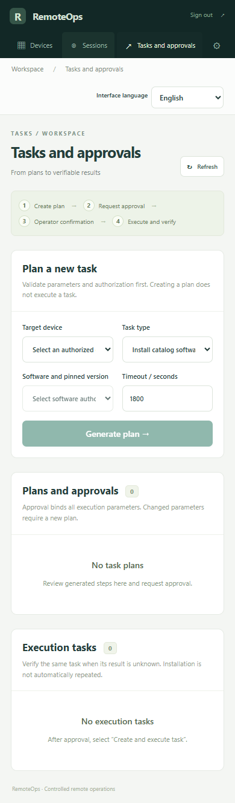
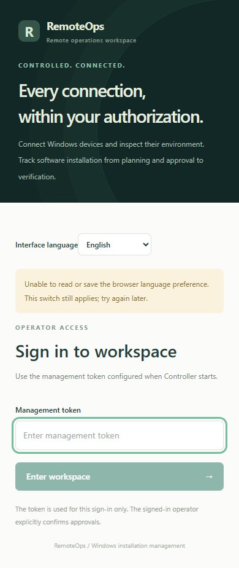
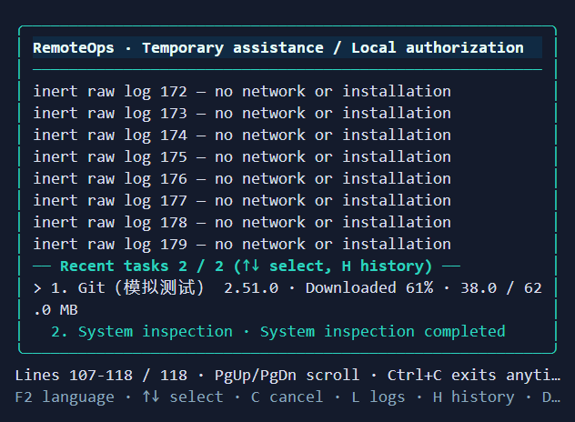
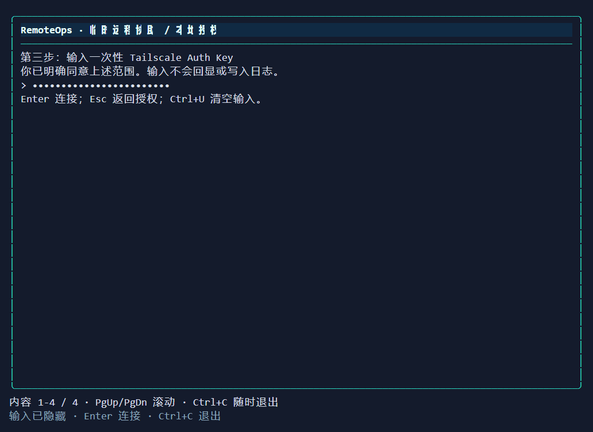

# 系统双语惰性验收 — 2026-10-12

本报告记录隔离分支 `feat/system-i18n` 的双语验收与构建，任务起点 `035229f`。程序自身的中文/英文界面、配置、任务显示及发布入口已按下述范围验证；发现的最小 GUI 英文裁切已修复并专项复验。主工作区整合、原有文件保留核对与最终交付由后续独立审查流程完成，本报告不把这些步骤描述为已完成。

环境：Windows amd64，Go 1.26.3，Node 22.22.1，Python 3.12.10，Chrome。实际显示器 DPI 为 120。发布构建使用 `CGO_ENABLED=0`；Go race 检测使用 `CGO_ENABLED=1`，这是检测器要求，不改变发布产物的 CGO 设置。

## 自动验证与构建

| 命令 / 检查 | 结果 |
|---|---|
| `CGO_ENABLED=0 go test ./... -count=1` | exit 0 |
| `go vet ./...` | exit 0 |
| `CGO_ENABLED=1 go test -race ./... -count=1` | 最后一次 exit 0；首次已有硬件查询测试超时，见下文 |
| `npm test`（web） | 3 文件、24 项通过，exit 0 |
| `node scripts/build.mjs` | typecheck / Vite build / 十个跨平台产物，exit 0 |
| `go test ./internal/i18n -run TestCatalogKeyAndPlaceholderParity -count=1` | exit 0 |
| 目录扫描 | 两种语言各 674 键；空值、占位符差异、479 处直接词条引用缺失均为 0；动态键另由 Go/Web 测试覆盖 |
| GUI 修复后 `go test ./internal/worker/ui/gui -count=1`、对应 `-race`、`go vet` | 全部 exit 0 |
| GUI 修复后 `node scripts/build.mjs --worker-only` | 两个 Worker 以 CGO=0 重建，摘要清单刷新，exit 0 |

首次全量 race 与构建/界面验收并发时，已有 `TestWindowsInspectionUsesUnprivilegedInventory` 超过其 15 秒期限而失败，没有 race detector 数据竞争报告。独立定向 race 重试在 1.83 秒通过；重型验收进程退出后，全量 race 再运行通过。保留首次失败、定向诊断及完整复验记录。全量检查覆盖语言功能和生成资源；之后仅修正 GUI 布局并完成对应 GUI 全包 test/race/vet，没有重复无关全量套件。

## 实际交互

| 入口 | 双语覆盖与可复核结果 | 边界 |
|---|---|---|
| Windows 原生 GUI | 最小 720×560 逻辑窗口，120 DPI 对应 DIB 900×700；下拉选择、展开后原生 Escape 按键消息、同意/密钥清除、ES_PASSWORD、连接后所选任务及日志首行保留、取消/断开/退出 | 在线场景使用注入的惰性 Connection；真实发布 GUI 读取模拟配对、输入未提交密钥、切换和保存后退出，不连接 |
| GUI DPI / 长英文 | 当前 120 DPI 及实际控件收到的合成 144 DPI 消息；真实字体和页头像素回归覆盖 96/120/144/192 DPI | 合成消息不是物理显示器 DPI 切换 |
| ConPTY TUI | zh-CN/en-US 各 60×18、100×30；Enter 不授权、F2 在授权前和在线选择、密钥页 F2 不切换、遮罩且原始输出不含密钥、保留原始日志、取消、确认断开、Ctrl+C | 实际终端输入/输出，任务与连接为惰性模拟；发布 console EXE 两种语言另验证授权至未提交的密钥输入及 Ctrl+C |
| ConPTY plain | 对应确认词“同意”/`AGREE`，另一语言确认词拒绝；真实 ReadPassword 不回显；授权前/在线 `lang`、稳定 `l 1`/`c 1`、当前语言断开确认 | 发布 console EXE 两种语言也验证隐藏输入后 Ctrl+C，不提交密钥 |
| 实际 Chrome 网页 | 两种语言的登录、401 诊断标识及五视图；1366×900 与 390×844；每个窄视图文档宽度均为 390；语言切换保留配置编辑值；刷新保存语言；存储读写抛错时切换仍生效、未提交令牌清除 | 单独启动的无头 Chrome、独立 context；静态构建配本地 loopback API mock，不启动 Controller、不访问真实会话 |
| 日期 / 数字 / 无障碍 | 真实 DOM 日期为中文 `2026/10/11 11:01:00`、英文 `10/11/2026, 11:01:00`，分别与浏览器 Intl 比较；内存 `1,234.0 GB` 与 Intl 比较；导航和设备搜索 accessible name 随语言变化；标题与 HTML lang 更新 | 数据为固定模拟记录，时区为 Asia/Shanghai |
| Windows 发布入口 | Controller/MCP/console Worker/GUI Worker 双语帮助 exit 0；非法语言和显式无效设置 exit 1；PE x64，前三者 console subsystem 3、GUI Worker subsystem 2 | Controller 只运行帮助和参数拒绝，不监听网络；MCP 只处理 initialize，不执行工具或 HTTP 请求 |
| MCP / helper | MCP 两种语言 stdout 仅一条合法 JSON-RPC initialize 响应，无诊断混入；helper 混合参数在设置初始化前拒绝 | 不触发安装、提升权限或 UAC |

各程序的偏好和测试文件使用独立临时路径，没有修改本机真实设置。网页 mock 进程仅在本任务浏览器检查期间运行，结束后核对其 PID/命令并停止；没有停止已有实例。

## 最小 GUI 裁切修复

视觉验收发现英文语言标签的 `(G)` 被截断，页头“Review and agree to the authorization”第二行被裁切，“Browse”按钮左侧也出现裁切。新增真实 Windows 字体测量发现“Read file”按钮的文字内边距同样不足。修复前，两项回归按预期失败：语言标签测量 91 逻辑像素而仅分配 64，Browse/Read file 需要文字宽度加 24 像素内边距，页头实际 DIB 少于完整文字的字形像素。

仅扩宽语言标签、Browse/Read file 按钮及页头状态区域，文件路径输入缩短 40 逻辑像素，保留控件 ID 和授权/任务/日志行为。回归以实际字体与无裁切原生文字绘制比较，不用模拟字体尺寸。两项测试由 RED 变 GREEN；完整 GUI 包 test/race/vet、两 Worker 构建、双语最小/DPI/任务/日志模拟及真实发布 GUI 复验均通过。修复前后图片均保留。

| 修复前：原生 PrintWindow DIB | 修复后：原生 PrintWindow DIB |
|---|---|
|  |  |

## 代表证据

下列 GUI 图片是实际 HWND 的 PrintWindow DIB，并非物理桌面截图。浏览器图片是实际无头 Chrome 页面截图。终端图片由真实 ConPTY ANSI 单元格栅格化生成，并非物理终端窗口截图；原始 ANSI 与文本帧保留在任务证据目录。

## 最终修复与证据范围

最终审查发现原生 GUI 加载新配对后，较迟送达的旧语言/轮询快照可能恢复旧控制器与授权范围。本轮在加载完成时再次递增本地版本，语言与轮询结果绑定当前语言请求，并在当前配对与所选语言的异步授权摘要到达前禁用同意/连接。语言完成仅更新授权说明与本地化反馈，不覆盖生命周期或任务。新增惰性原生回归涵盖加载前/加载中捕获的晚到结果、不同控制器和管理员范围、重复选择同一语言、当前语言摘要及连接控件状态。网页节点清理说明改由稳定 `cleanup_pending` 状态生成中英文文案，不反向匹配服务端字符串，不改 API 状态或字段。

本轮新增回归 RED/GREEN、GUI 包 test/race/vet、Web 3 文件 25 项测试、675 键目录一致性和 480 处直接引用检查均通过；最后补强的原生授权/语言请求回归还以旧实现 overlay 验证 RED，并在当前实现重跑 test/race 为 GREEN。`node scripts/build.mjs` 本轮仅执行一次，typecheck、Vite 与十个 CGO=0 产物成功；现有 npm glob 弃用提示保留。十个输出摘要、四个 Windows PE 子系统和四个嵌入 Web 文件逐字节一致性已核对。

前述 Task 5 的实际浏览器、ConPTY、原生 DIB 和发布入口截图/运行结果仍是修复前的惰性验收记录，本轮未重跑这些验收，不把旧截图或旧发布摘要称为新产物的运行证据。浏览器 `page_errors: []` 只适用于最初安装监听器的页面；存储拒绝的第二页面只凭 DOM 断言证明切换、提示和未提交令牌清除，未据此声称该页面无 pageerror。本轮原始日志与新版摘要位于同级 `final-fix-*` 文件，`task5/` 原始验收内容及摘要未改写。

## 当前构建摘要

十个产物逐项重新计算 SHA-256，与 `dist/SHA256SUMS` 一致；下表是最终授权新鲜度与 Web 清理文案修复后四个 Windows 输出的摘要，仅为本轮构建核对；不是重新运行发布入口验收。Linux/macOS 只完成交叉构建和摘要核对，没有运行验收。

| Windows amd64 文件 | SHA-256 |
|---|---|
| `remoteops-controller-windows-amd64.exe` | `8bf17d99680a938080ad4917854b8b4f0861e67666840b081da3b7fe7d3e7d18` |
| `remoteops-mcp-windows-amd64.exe` | `ba24297f7dfac79f4db2c3d099d501d8a6800da3b3df9fad1008f56f746bedb7` |
| `remoteops-worker-windows-amd64.exe` | `5ffb69a5c820f12dae78b5e55963e71b4e81472fad8b28e5587dfde30bec12e9` |
| `remoteops-worker-gui-windows-amd64.exe` | `dcd80a25efb014226d14c63e727dc7083d84f2436b35081219f443c9ce4c1820` |

完整命令输出、临时测试脚本、JSON 检查记录、摘要、原始 ConPTY 输出和修复前后图片位于隔离工作区 `.superpowers/sdd/2026-10-12-system-i18n/task5/`。最终审查/整合后计划归档到主目录 `dist/system-i18n-evidence-20261012.zip`；本报告不宣称该最终归档已生成。

本次没有验证真实异地网络、真实软件下载/安装、UAC 决策、真实审批/Controller 运行、硬件键盘人工操作或 Linux/macOS 运行时。真实安装与安全边界继续按[人工验收矩阵](manual-acceptance.md)执行。语言选择与失败恢复规则见[语言设置](../language-settings.md)。
