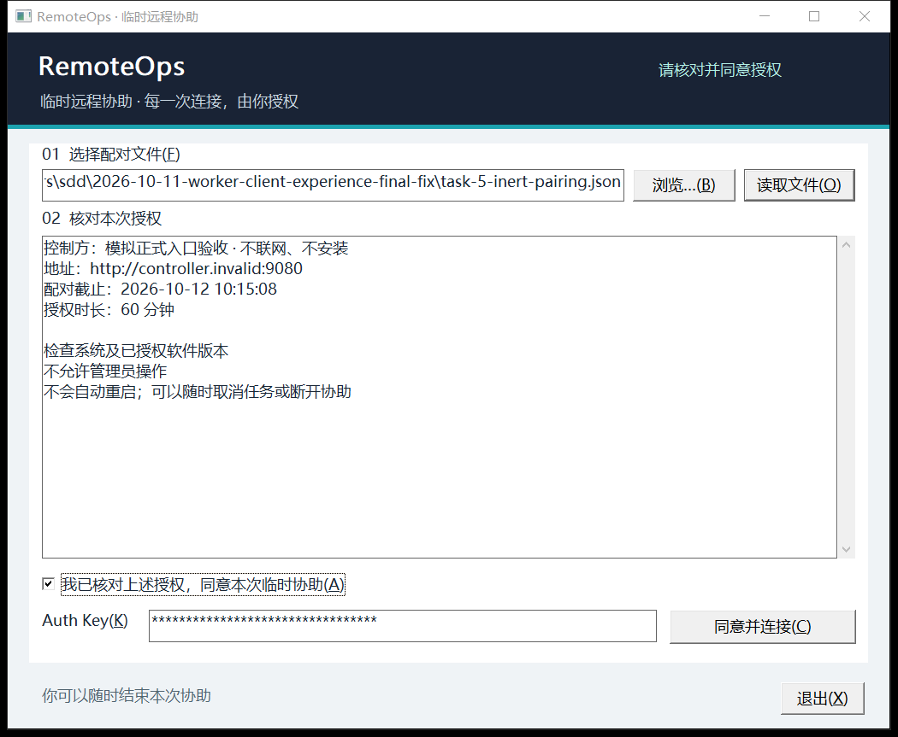
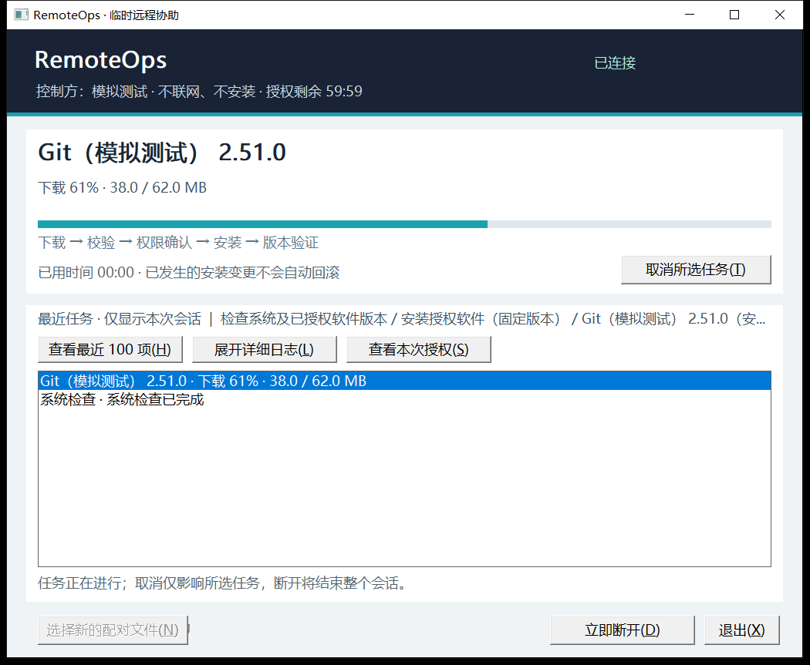
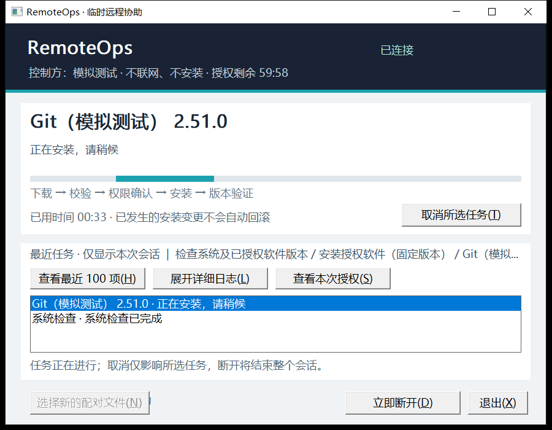
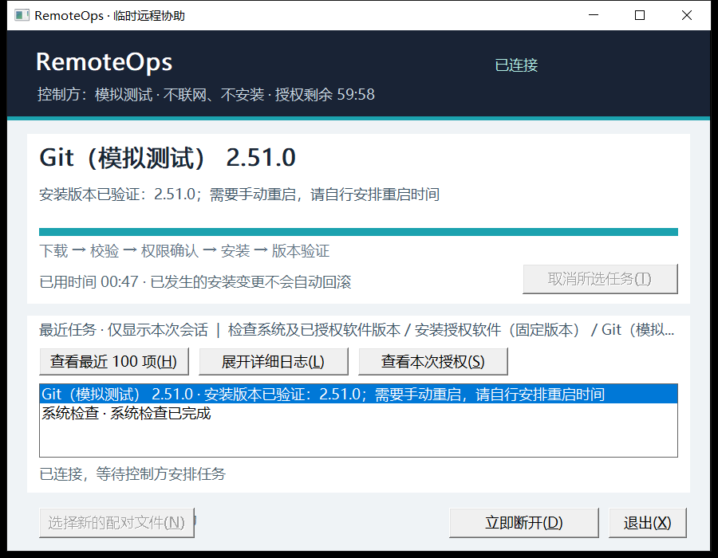
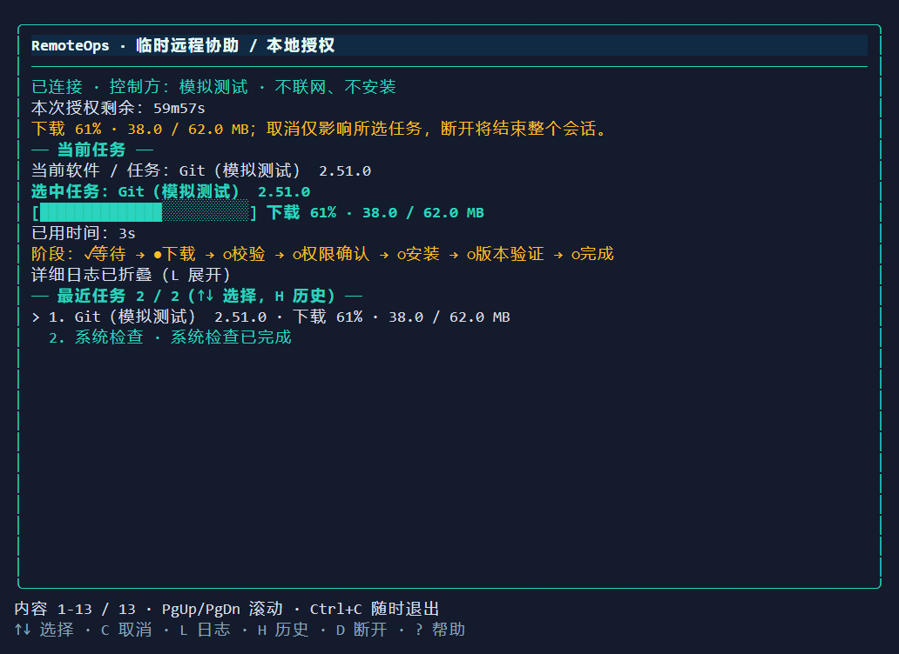

# Worker 客户端验收记录 · 2026-10-11

实施与最终验证完成于2026-10-12，隔离 worktree 为 `C:/Users/cc/.codex/worktrees/74f9/prj_installer`。本记录覆盖共享客户端、原生 GUI/TUI 接入入口及两个正式 Windows x64 EXE；真实安装仍按[人工验收矩阵](manual-acceptance.md)暂缓。

## 自动验证

| 验证 | 结果 |
|---|---|
| `go test ./... -count=1` | PASS，16个测试包；MCP命令无测试文件 |
| `go test -race ./... -count=1` | PASS，同上 |
| `go vet ./...` | exit0，无输出 |
| 最后 helper 参数路由修复后 `go test ./cmd/worker -count=1` | PASS，3.045s |
| 最后修复后 `go test -race ./cmd/worker -count=1` / `go vet ./cmd/worker` | PASS，6.647s / exit0 |
| 主工作区前端 `npm --prefix web run typecheck` / `npm --prefix web test -- --run` | 父协调者2026-10-12验证，exit0 / 2文件12测试PASS；本变更无前端修改，未重复 |
| `node scripts/build.mjs --worker-only` | exit0；`CGO_ENABLED=0`，两个正式EXE和一致SHA256SUMS |

全套Go验证在入口完成后集中运行一次。后续自审发现已解析helper后遇未知flag的错误路由问题，先观察新增回归失败再修复，仅重跑受影响的cmd/worker测试、race、vet并重构正式EXE。已有本地诊断令牌及Origin测试保留并通过。

入口回归先执行 `go test ./cmd/worker -run TestCLIParameterRegression -count=1 -v`：旧入口6个新增要求失败（help无UI、未知UI、三类helper冲突、位置参数）；拒绝AuthKey参数既有行为通过。替换入口后7项全通过。解析表进一步覆盖旧 `--pairing`、三种UI、两个构建默认值、空值及缺值、helper优先与互斥；生产没有测试连接或自动授权参数。

## 最终审查修复回归

2026-10-12 最终审查的四项 finding 已修复：共享 100 项及 GUI/TUI/plain 默认 20 项在硬上限内保留执行中任务，其余槽位显示最新历史，最终保持稳定时间顺序；当前任务在默认列表可选、可取消。运行任务、排队任务取消中和系统检查成功均使用共享中文状态文案，在线 Notice 随当前活动更新。原生长日志完整读取，静止日志不重写；同任务更新保留文本选择和读旧行位置，仅已在末尾且没有文本选择时跟随新增输出。真实 Server 的执行锁串行所有任务，至多一项 running；超过限额 running 的替身输入仍按硬上限显示最近执行项。

审查的三个临时复现加入所属包，先复现运行任务丢失、GUI 默认选错和静止长日志滚动复位，再修复。新增测试覆盖 100/20 边界、稳定 ID/编号与实际取消目标、长日志超过 8192 字符及已完成任务、追加时阅读位置/选择、末尾跟随和中文回归。`go test ./internal/worker ./internal/worker/client ./internal/worker/ui/gui ./internal/worker/ui/tui -count=1` 全部 PASS（4.884s / 3.256s / 4.568s / 2.989s）；对应 `-race` 全部 PASS（6.135s / 10.447s / 10.185s / 5.277s），`go vet` exit0。随后加强已完成长日志断言的单一 focused 测试 PASS（2.077s），没有新的生产改动。

本轮重新执行 `node scripts/build.mjs --worker-only` 并使用既有 `task-5-artifact-smoke.py` 原样副本校验下列当前产物，全部 PASS。既有 Task 5 全仓验证保留其历史身份；最终整合后的全仓验证由协调者执行。新证据保存到忽略目录 `.superpowers/sdd/2026-10-11-worker-client-experience/final-fix-artifacts/`，原始 RED/GREEN 和受影响包输出保留在本 plan 协调目录，完整处理记录为 `final-fix-report.md`。

## 正式产物

| 产物 | PE | SHA256 |
|---|---|---|
| `remoteops-worker-windows-amd64.exe` | x64，Console subsystem3 | `1e2a48b558571b7ed4591ed00df348654df344194a854be24230d5d3850730b5` |
| `remoteops-worker-gui-windows-amd64.exe` | x64，Windows GUI subsystem2 | `77b1a417e2829dac22fdab0be79469ee0185ed98a9847bc421402a18da48960c` |

两者均用同一个 `./cmd/worker` 编译，保留trimpath/strip；console链接默认tui，GUI链接 `-H=windowsgui -X main.defaultUI=gui`。实际 `--help` 均exit0并列出gui|tui|plain，hash与dist/SHA256SUMS逐项匹配。脚本只构建，不启动Controller；本worktree dist只有这两个Worker EXE及清单。

[正式产物检查结果JSON](assets/worker-client-2026-10-11/formal-artifact-results.json)来自实际EXE。GUI无参数启动原生窗口，浏览对话框取消后读取仅含检查权限的惰性JSON，确认同意前连接/密钥不可用、勾选后密钥具有ES_PASSWORD且保留遮罩输入；未点击连接即安全关闭。未知UI参数在可见原生错误框显示并exit1。console无参数在实际ConPTY启动TUI，输入同一文件、Enter不授权、Y后测试密钥显示圆点、Ctrl+C退出；测试密钥从未提交。因此正式入口验收没有网络连接或真实会话。

上图由正式EXE实际HWND的PrintWindow采集，是窗口像素截图；桌面实际为120DPI/125%，不是早期非DPI-aware查询的96DPI。

## 已完成模拟UI流程证据

下列既有完整流程由协调者用仅存在于忽略目录的测试harness完成，本轮未重复完整流程；为校验修复文案，仅重新捕获一张 100×30 TUI 模拟下载帧。其Connector返回惰性模拟连接；未调用tsnet、下载器、安装器或UAC。图中“已连接”“正在安装”“成功”均为模拟状态，不代表真实网络或软件更改。

- [GUI实际流程](assets/worker-client-2026-10-11/gui-flow-results.json)：同意门槛、ES_PASSWORD、提交后清空密钥、所选日志/授权、取消、断开、新配对、原生文件对话框取消、无效JSON拒绝连接、关闭全部PASS。
- [GUI键盘修复验收](assets/worker-client-2026-10-11/gui-keyboard-fix-results.json)：真实键盘输入、包含l/d/x/c的密钥保留遮罩、连接视图切换后立即Alt+L/Alt+D/Alt+X可用，PASS。
- [TUI实际ConPTY流程](assets/worker-client-2026-10-11/tui-flow-results.json)：100×30及60×18，Enter不授权、N拒绝、Y明确同意、密钥不出现在ANSI输出、所选日志、取消、断开确认、Ctrl+C全部PASS。
- [plain实际ConPTY流程](assets/worker-client-2026-10-11/plain-flow-results.json)：中文明确同意、ReadPassword不回显、取消、断开确认、退出全部PASS。

以上为实际测试HWND通过PrintWindow捕获的截图。最小窗口为900×700物理像素，对应120DPI下720×560逻辑尺寸。另保存[同意与遮罩截图](assets/worker-client-2026-10-11/gui-final-consent.png)。协调者还验证未知总长度仅显示38MB与活动指示、授权过期与心跳失联原因、日志及完整范围可阅读；NO_COLOR仍保留边框、文字和进度表达。

TUI图已替换为最终修复后的实际 ConPTY 捕获渲染，Notice 与运行历史均显示真实模拟下载比例，检查历史显示“系统检查已完成”；Ctrl+C 正常退出。测试渲染器先绘制背景再绘制字符，避免背景覆盖双宽中文字，未改动捕获数据。它不是桌面截图。[96DPI](assets/worker-client-2026-10-11/gui-native-96.png)、[144DPI](assets/worker-client-2026-10-11/gui-native-144.png)、[192DPI](assets/worker-client-2026-10-11/gui-native-192.png)是测试窗口接收WM_DPICHANGED后，生产paintDC及原生控件WM_PRINT输出至GDI DIB的等效原生绘制图，也不是桌面截图；测试核对控件实际矩形，视觉复核未见重叠。

## 安全边界与限制

通信保持普通用户权限；窗口读取配对文件不连接，密钥只能本地遮罩输入。helper在UI创建前优先分流，不能带配对/UI/位置参数；无自动浏览器、WebView2、生产demo或自动授权flag。GUI安全清理超过8秒仍显示清理窗口直至完成，优先保证撤销与清理；本次正式验收未发起连接，因此未测真实网络清理延迟。

未修改远程TaskSpec、签名、审批或安装模板。没有真实安装、UAC决策、真实会话、Controller/已有Worker停启命令，也未替换任何运行产物。协调者恢复时原Controller PID31928已不存在；最终只读查询remoteops-*无进程输出，不能据旧baseline声称Controller在线。主工作区16个原有dirty/untracked文件由父协调者保留并核验；整合及主dist更新由父协调者负责。

本次没有跨机器tailnet连通、真实安装成功/取消/UAC/reboot或Windows10实机验收证据。模拟结果只用于验证本地界面和操作边界。未来诊断保留handler在cmd/worker/local.go，生产入口不启动其HTTP服务。
